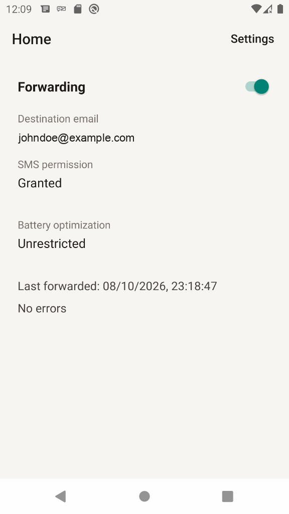
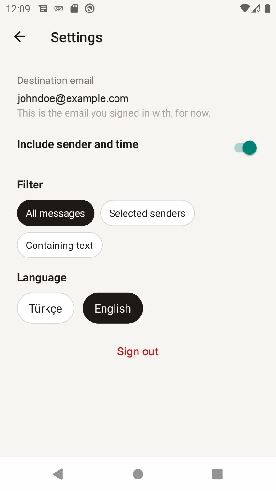

<div align="center">
  
  <h1>SMS Forwarder</h1>
  <p>
    Incoming SMS, delivered to your own email.<br />
    Android 10 and newer · English and Turkish<br />
    <a href="README.tr.md">Türkçe</a>
  </p>
</div>

<table align="center">
  <tr>
    <td align="center">
      
      <br />
      <b>Home</b>
    </td>
    <td align="center">
      
      <br />
      <b>Settings</b>
    </td>
  </tr>
</table>

<p align="center">
  SMS often carry bank alerts and verification codes. Run this only on your own phone, and only to your own inbox.
</p>

## What it does

- Sign-in with a 6-digit email code. New accounts start with forwarding off.
- A home switch turns forwarding on. A foreground notification stays visible while it is on.
- Incoming SMS go to a Supabase Edge Function, which sends them through your SMTP server.
- Filters: every message, selected senders, or text the message contains.
- Optional sender and time in the email.
- The same message is skipped for 5 minutes. Sends are capped at 10 per minute and 200 per day.
- Battery-optimization exemption is optional, so messages can still leave while the phone sleeps.

## Privacy

The message text is sent in the email and is not written to the database. Deduping stores a key for 5 minutes. The send log stores only the user id and the time, so the function can rate-limit. SMTP passwords stay in Supabase secrets. The app only receives `SUPABASE_URL` and `SUPABASE_ANON_KEY`.

## Run it yourself

You need Node.js 22.11 or newer, the React Native Android environment, a Supabase project, and an SMTP server for both the sign-in code and the forwarded SMS.

```sh
npm install
cp .env.example .env
```

Fill `.env` with your project URL and anon key. Leave that file uncommitted.

```sh
npm start
npm run android
```

`minSdk` is 29 and `targetSdk` is 34.

### Backend

Link this repo to your own Supabase project. The migration only adds `smsfwd_on_auth_user_created`. It does not replace other triggers on `auth.users`.

```sh
supabase login
supabase link --project-ref <your-project-ref>
supabase db push
```

That creates `smsfwd_profiles`, `smsfwd_dedupe`, `smsfwd_send_log`, and `smsfwd_prune()`.

Supabase already injects `SUPABASE_URL`, `SUPABASE_ANON_KEY`, and `SUPABASE_SERVICE_ROLE_KEY`. Set the mail server yourself:

```sh
supabase secrets set \
  SMTP_HOST="<your-smtp-host>" \
  SMTP_PORT="<465-or-587>" \
  SMTP_USER="<your-smtp-user>" \
  SMTP_PASS="<your-smtp-password>" \
  SMTP_FROM="<sender@your-domain>"
```

Port 465 uses implicit TLS. Port 587 uses STARTTLS.

```sh
supabase functions deploy forward-sms --project-ref <your-project-ref>
```

In the Supabase dashboard, open **Authentication → Emails → SMTP Settings** and enter the same server. Auth mail is separate from the Edge Function secrets. Use a code template, not a magic link:

```text
TR: Giriş kodun: {{ .Token }}
EN: Your sign-in code: {{ .Token }}
```

Turn forwarding on for a user before expecting a real send. A check with that user's access token:

```sh
curl -sS -X POST "$SUPABASE_URL/functions/v1/forward-sms" \
  -H "Authorization: Bearer $ACCESS_TOKEN" \
  -H "apikey: $SUPABASE_ANON_KEY" \
  -H "Content-Type: application/json" \
  -d '{"sender":"+905551112233","body":"Your code is 123456","timestamp":1733660400000,"dedupe_key":"905551112233|1733660400000|ab12cd34"}'
```

`{"status":"sent"}` means the mail went out. The same `dedupe_key` inside 5 minutes returns `{"skipped":"duplicate"}`. Forwarding off returns `{"skipped":"disabled"}`.

### Release APK

Release signing reads `MYAPP_UPLOAD_STORE_FILE`, `MYAPP_UPLOAD_STORE_PASSWORD`, `MYAPP_UPLOAD_KEY_ALIAS`, and `MYAPP_UPLOAD_KEY_PASSWORD` from `~/.gradle/gradle.properties`. Keep the keystore and those values off the repository.

```sh
cd android && ./gradlew assembleRelease
```

The signed APK is `android/app/build/outputs/apk/release/app-release.apk`.

## Layout

| Path | Role |
| --- | --- |
| `src/` | React Native screens, OTP sign-in, settings |
| `android/app/src/main/java/com/smsforwarder/sms/` | SMS receiver, foreground service, upload worker |
| `supabase/migrations/` | Profiles, dedupe, send log |
| `supabase/functions/forward-sms/` | Filter, rate limit, SMTP send |
