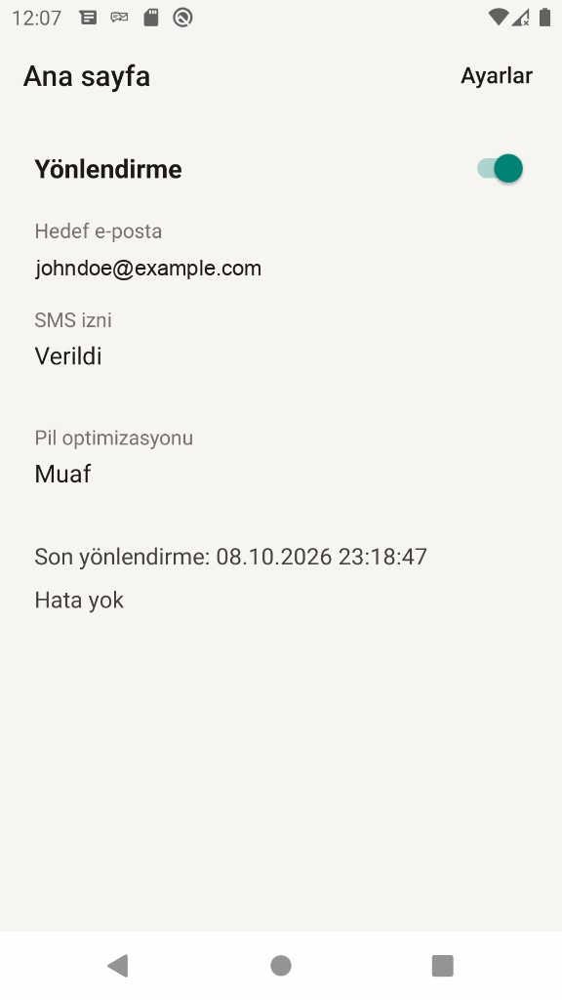
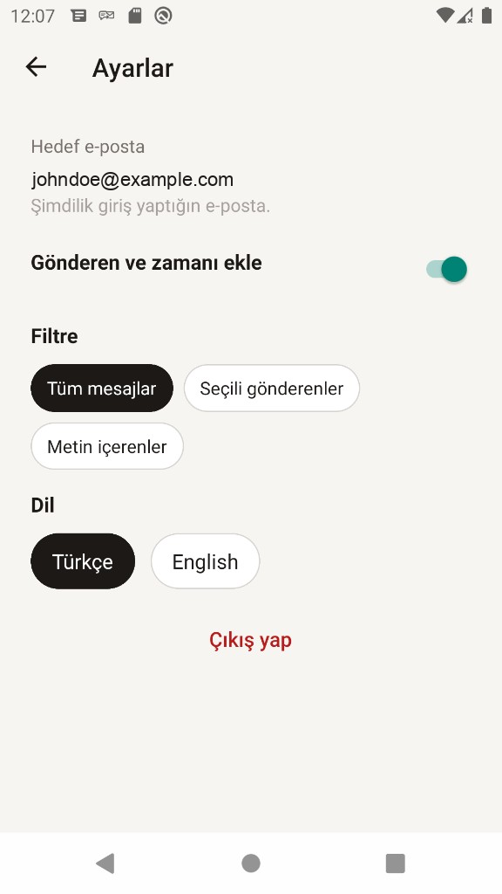

<div align="center">
  
  <h1>SMS Forwarder</h1>
  <p>
    Gelen SMS'ler, kendi e-postana.<br />
    Android 10 ve sonrası · Türkçe ve İngilizce<br />
    <a href="README.md">English</a>
  </p>
</div>

<table align="center">
  <tr>
    <td align="center">
      
      <br />
      <b>Ana sayfa</b>
    </td>
    <td align="center">
      
      <br />
      <b>Ayarlar</b>
    </td>
  </tr>
</table>

<p align="center">
  SMS'ler çoğu zaman banka bildirimi ve doğrulama kodu taşır. Bunu yalnızca kendi telefonunda ve kendi e-postan için kullan.
</p>

## Ne yapar

- 6 haneli e-posta koduyla giriş. Yeni hesaplarda yönlendirme kapalı başlar.
- Ana ekrandaki anahtar yönlendirmeyi açar. Açıkken bildirim çubuğunda sürekli bir bildirim durur.
- Gelen SMS bir Supabase Edge Function'a gider; e-postayı senin SMTP sunucun gönderir.
- Süzgeç: tüm mesajlar, seçili gönderenler veya metinde geçen ifade.
- İstenirse e-postaya gönderen ve saat eklenir.
- Aynı mesaj 5 dakika boyunca tekrar gönderilmez. Limit dakikada 10, günde 200 gönderimdir.
- Pil optimizasyonu muafiyeti isteğe bağlıdır; telefon uyurken de iletim sürebilir.

## Gizlilik

Mesaj metni e-postayla gider ve veritabanına yazılmaz. Tekrar kontrolü 5 dakika boyunca bir anahtar tutar. Gönderim kaydı yalnızca kullanıcı kimliği ve zamanı saklar; fonksiyon bununla hız sınırını uygular. SMTP şifreleri Supabase secret'larında kalır. Uygulama yalnızca `SUPABASE_URL` ve `SUPABASE_ANON_KEY` alır.

## Kendin çalıştır

Node.js 22.11 veya daha yenisi, React Native Android ortamı, bir Supabase projesi ve hem giriş kodu hem iletilen SMS için bir SMTP sunucusu gerekir.

```sh
npm install
cp .env.example .env
```

`.env` içine kendi proje adresini ve anon anahtarını yaz. Bu dosyayı repoya koyma.

```sh
npm start
npm run android
```

`minSdk` 29, `targetSdk` 34'tür.

### Sunucu

Bu repoyu kendi Supabase projene bağla. Migration yalnızca `smsfwd_on_auth_user_created` ekler. `auth.users` üzerindeki başka trigger'ları değiştirmez.

```sh
supabase login
supabase link --project-ref <proje-ref>
supabase db push
```

Bu adım `smsfwd_profiles`, `smsfwd_dedupe`, `smsfwd_send_log` ve `smsfwd_prune()` oluşturur.

Supabase `SUPABASE_URL`, `SUPABASE_ANON_KEY` ve `SUPABASE_SERVICE_ROLE_KEY` değerlerini kendisi verir. Posta sunucusunu sen tanımlarsın:

```sh
supabase secrets set \
  SMTP_HOST="<smtp-sunucun>" \
  SMTP_PORT="<465-veya-587>" \
  SMTP_USER="<smtp-kullanıcın>" \
  SMTP_PASS="<smtp-şifren>" \
  SMTP_FROM="<gonderen@alanadin>"
```

465 kapısı doğrudan TLS kullanır. 587 kapısı STARTTLS kullanır.

```sh
supabase functions deploy forward-sms --project-ref <proje-ref>
```

Supabase panelinde **Authentication → Emails → SMTP Settings** altına aynı sunucuyu yaz. Auth postası, Edge Function secret'larından ayrıdır. Sihirli bağlantı yerine kod şablonu kullan:

```text
TR: Giriş kodun: {{ .Token }}
EN: Your sign-in code: {{ .Token }}
```

Gerçek bir iletim beklemeden önce o kullanıcıda yönlendirmeyi aç. Kullanıcının erişim belirteciyle deneme:

```sh
curl -sS -X POST "$SUPABASE_URL/functions/v1/forward-sms" \
  -H "Authorization: Bearer $ACCESS_TOKEN" \
  -H "apikey: $SUPABASE_ANON_KEY" \
  -H "Content-Type: application/json" \
  -d '{"sender":"+905551112233","body":"Your code is 123456","timestamp":1733660400000,"dedupe_key":"905551112233|1733660400000|ab12cd34"}'
```

`{"status":"sent"}` postanın gittiğini söyler. Aynı `dedupe_key` 5 dakika içinde `{"skipped":"duplicate"}` döner. Yönlendirme kapalıysa yanıt `{"skipped":"disabled"}` olur.

### Release APK

Release imzası `MYAPP_UPLOAD_STORE_FILE`, `MYAPP_UPLOAD_STORE_PASSWORD`, `MYAPP_UPLOAD_KEY_ALIAS` ve `MYAPP_UPLOAD_KEY_PASSWORD` değerlerini `~/.gradle/gradle.properties` dosyasından okur. Keystore ve bu değerler repoda durmamalı.

```sh
cd android && ./gradlew assembleRelease
```

İmzalı APK: `android/app/build/outputs/apk/release/app-release.apk`.

## Dizin

| Yol | İş |
| --- | --- |
| `src/` | React Native ekranları, OTP girişi, ayarlar |
| `android/app/src/main/java/com/smsforwarder/sms/` | SMS alıcısı, ön plan servisi, yükleme işçisi |
| `supabase/migrations/` | Profil, tekilleştirme, gönderim kaydı |
| `supabase/functions/forward-sms/` | Süzgeç, hız sınırı, SMTP gönderimi |
